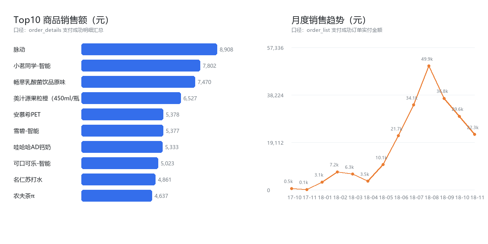

# 无人售货机零售数据仓库

> 把《数据仓库与 ETL》课程里 4 个孤立的 Kettle 转换作业，重做成一套**分层建模 + 维度建模 + 数据质量校验**的完整数据仓库项目。



**规模**：30,835 笔订单 · 40,237 行明细 · 404 种商品 · 63 台售货机 · 2017-10 ~ 2018-11 共 13 个月

---

## 1. 项目背景

课程实验（无人售货机零售项目）原本只要求用 Kettle 做 4 个转换、导出 4 个 Excel：

1. 分组聚合客户订单
2. 计算各商品销售金额
3. 统计各售货机日销售金额
4. 整理各售货机情况（利润、客单价）

这能交作业，但**没有建模、没有分层、没有调度、没有质量校验**，产物是 4 张散落的表。

本项目保留这 4 个业务的**口径**（保证结果与老师要求一致），在此之上补齐工程化部分：

- 三层分层建模：`DWD` 明细 → `DIM` 维度 + `FACT` 事实（星型）→ `ADS` 应用
- 商品维做 **SCD2**（同名商品不同售价保留历史版本）
- 自动化**数据质量校验**并生成报告
- 一条命令端到端重建，结果可复现

## 2. 数据集

| 源表 | 行数 | 字段 | 说明 |
|---|---|---|---|
| `order_list.csv` | 30,835 | 19 | 订单头：金额、状态、来源、售货机 |
| `order_details.csv` | 40,237 | 27 | 订单行：商品、数量、成本/销售价、利润 |
| `box_list.csv` | 55 | 8 | 售货机维：地址、型号、在线状态 |

源文件为 **GBK 编码**（直接用 UTF-8 读取会抛 `UnicodeDecodeError`）。

> 原始数据含 11,728 个真实手机号，**不随仓库分发**，见 [第 8 节](#8-合规与数据说明)。

## 3. 架构

```
data/raw/*.csv (GBK)
      │  extract：编码探测与归一、类型转换、手机号脱敏
      ▼
    DWD           dwd_order / dwd_order_item        # 明细，保留全量
      │  clean：去重、过滤、商品名清洗、型号标准化、利润计算
      ▼
  DIM + FACT      dim_date / dim_product(SCD2) / dim_machine / dim_customer
      │           fact_order_item（粒度：订单行）
      ▼
    ADS           ads_customer_rank / ads_product_sales
      │           ads_machine_daily / ads_machine_profit
      ▼
  data/out/*.csv + docs/dq_report.md
```

## 4. 分层设计

| 层 | 表 | 关键设计 |
|---|---|---|
| DWD | `dwd_order`、`dwd_order_item` | 保留原始粒度；清洗但不聚合；记录 `product_name_raw` 与原值对照 |
| DIM | `dim_date` | 392 天日期维，含季度、星期、是否周末 |
| DIM | `dim_product` | **SCD2**：`(商品名, 售价)` 作为一个版本，`valid_from/valid_to/is_current` |
| DIM | `dim_machine` | 型号 5 种写法归一为 `MA650-A`；维表缺失的机器补 `is_orphan=1` 占位行 |
| DIM | `dim_customer` | 首末单日期、订单数、累计消费 |
| FACT | `fact_order_item` | 粒度 = 订单行；外键关联 4 个维度；含 `profit` 度量 |
| ADS | 4 张结果表 | 一一对应课程的 4 个任务 |

**利润口径**（沿用课程公式）：

```
利润 = 商品实付金额 − (数量 × 成本价) − 商品优惠金额
客单价 = 售货机销售金额 ÷ 售货机订单数
```

## 5. 结果（真实计算值）

| 任务 | 结果表 | 行数 | Top1 |
|---|---|---|---|
| 1 客户订单聚合 | `ads_customer_rank` | 11,695 | 客户 `220759`：175 笔 / 880.60 元 |
| 2 商品销售金额 | `ads_product_sales` | 388 | 脉动：2,234 件 / 8,907.99 元 |
| 3 售货机日销售 | `ads_machine_daily` | 4,861 | 63 台 × 334 个交易日（非每日都有单） |
| 4 售货机利润 | `ads_machine_profit` | 63 | 山东医专第一附属医院（3）南边：利润 11,156.15 元 |

**经营结论**

- **增长**：2018-08 为峰值月，销售额 49,867 元，是 2017-10（494 元）的约 100 倍，处于设备投放扩张期；2017-12 无任何交易记录，属数据缺口
- **商品**：集中度中等，Top10 商品占总销售额 **27.3%**，饮料类是主力（脉动、小茗同学、果粒橙、雪碧、可乐）
- **机位**：差异极大。前 3 台（均为山东医专第一附属医院场景）利润 8,486 ~ 11,156 元；第 4、5 名是 4S 店，利润 2,227 ~ 2,522 元，约为医院的 **1/4**
- **客单价**：前 5 台机器集中在 6.97 ~ 7.63 元，全站均值 9.72 元 —— 典型「高频小额」，适合组合促销而非大额满减

## 6. 数据质量体检

`docs/dq_report.md` 由代码自动生成，共发现 **5 类真实问题**：

| # | 问题 | 量化 | 处理 |
|---|---|---|---|
| 1 | 源文件 GBK 编码 | 3/3 个文件 | 编码探测 + 归一 |
| 2 | 订单头与明细金额对不上 | 225,250.76 vs 224,379.27，差 **871.49 元（0.387%）** | 保留差额并在报告说明（疑似退款/拆单），不做强行平账 |
| 3 | 售货机维表缺失 | 订单中出现 63 台，维表只有 55 台，**8 台孤儿** | 补 `is_orphan=1` 占位行，保留数据不丢 |
| 4 | 型号 5 种写法 | `MA650-A`/`MA650A`/`MA-650A`/`MA650`/`MA` | 映射表归一为 `MA650-A` |
| 5 | 商品名脏值 | **6,902 行尾带 `\t`**、6 行首尾空格、26 行空值 | 清洗后合并同商品，空值剔除出事实表 |

另有 **79 条 `INIT` 初始化订单**（非真实交易，631.50 元）已排除在事实表外。

## 7. 正确性校验：与课程指导书结果一致

指导书在讲解结果时给出两个具体数值，本项目用真实数据复算，**完全吻合**：

| 指标 | 指导书 | 本项目 | |
|---|---|---|---|
| 脉动 销量 / 销售额 | 2,234 件 / 8,907.99 元 | 2,234 件 / 8,907.99 元 | ✅ |
| 客户 220759 订单数 / 消费额 | 175 笔 / 880.60 元 | 175 笔 / 880.60 元 | ✅ |

这说明 ETL 口径与老师要求一致，不是自己另立一套。

## 8. 合规与数据说明

- **不提交原始数据**：`data/raw/*.csv`、`data/dw.db`、`data/out/*.csv` 均在 `.gitignore` 中
- **手机号脱敏**：入库即转 `138****8888`，报告中不出现完整号码
- 课程实验指导书（PDF）与原始数据版权归授课教师与数据提供方，仓库不包含
- 想复现：把 3 个 CSV 放进 `data/raw/` 后执行 `python run_all.py`

## 9. 快速开始

```bash
pip install -r requirements.txt

# 1. 放入数据
#    data/raw/order_list.csv
#    data/raw/order_details.csv
#    data/raw/box_list.csv

# 2. 一键构建（建表 → DWD → DIM/FACT → ADS → 质量报告）
python run_all.py

# 3. 生成 README 预览图
python src/report_chart.py
```

输出：

```
data/dw.db              # SQLite 数据仓库
data/out/*.csv          # 4 张 ADS 结果（utf-8-sig，Excel 可直接打开）
docs/dq_report.md       # 数据质量报告
docs/preview.png        # 预览图
```

## 10. 目录结构

```
vending-dw/
├── run_all.py              # 端到端流水线
├── requirements.txt
├── sql/
│   └── schema.sql          # 全部建表 DDL（分层/索引/注释）
├── src/
│   ├── config.py           # 路径、编码探测、脱敏、批量写入
│   ├── clean.py            # DWD 清洗层
│   ├── dw.py               # 维度（含 SCD2）与事实构建
│   ├── ads.py              # 4 张 ADS 结果
│   ├── dq.py               # 质量校验 + Markdown 报告
│   └── report_chart.py     # Pillow 预览图
├── data/raw/               # 原始 CSV（不入库）
├── data/out/               # 结果导出（不入库）
└── docs/
    ├── dq_report.md
    ├── data_dictionary.md
    └── preview.png
```

## 11. 技术栈

Python 3.12 · pandas 3.0 · SQLite（零依赖，可平移到 MySQL/Hive）· Pillow（图表）

> 之所以用 SQLite：课程环境是 Kettle，但 Kettle 的 `.ktr` 不利于展示。本项目用纯 SQL + Python 复现同样口径，便于阅读、复跑和面试讲解；`sql/schema.sql` 可直接改写为 MySQL/Hive 方言。
